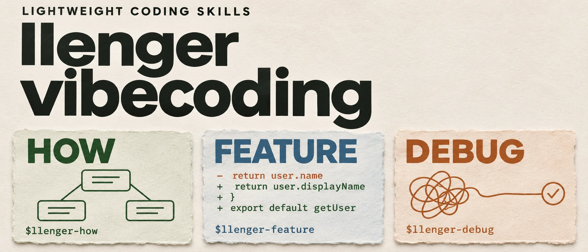

<p align="center"><a href="README.md">简体中文</a> · <strong>English</strong></p>

<p align="center">
  
</p>

# llenger-vibecoding

**Understand the project. Build the feature. Fix the root cause.**

Three lightweight coding skills for **Codex / ZCode**. Invoke the one you need; the main agent drives the work. Development and fixes finish with actual verification and an independent review.

[Choose an entry point](#choose-an-entry-point) · [Install](#install) · [Hosts and review](#hosts-and-review) · [Design and validation](#design-and-validation)

## Choose an entry point

### 🧭 How · Understand before deciding what to change

Explore an unfamiliar open-source project: runtime flow, deployment relationships, and where a future change belongs. Read-only by default, with findings delivered in the conversation.

```text
$llenger-how Walk me through this open-source project: deployment,
the model request path, and where I would add a custom provider.
```

### 🛠️ Feature · Turn an idea into a verifiable change

Settle the goal, scope, and acceptance criteria. Build the smallest sufficient implementation, verify its behavior, and get an independent review.

```text
$llenger-feature Add status filtering to the task list.
Use the existing code to clarify the requirements first.
```

### 🔍 Debug · Trace the symptom to its source

Start with a screenshot, error, or short description. Establish the root cause, apply a targeted fix, and check for regressions.

```text
$llenger-debug Search results go blank when I change filters on page two.
Investigate and fix it.
```

The three entry points are independent. How is optional before development; an existing handoff workflow continues to carry work-in-progress context.

## Install

Clone the repository and link the skills into your user-level directory. For a first installation in a macOS / Linux shell:

```sh
git clone https://github.com/zj-linjie/llenger-vibecoding.git
cd llenger-vibecoding

mkdir -p "$HOME/.agents/skills"
ln -s "$PWD/skills/llenger-how" "$HOME/.agents/skills/llenger-how"
ln -s "$PWD/skills/llenger-feature" "$HOME/.agents/skills/llenger-feature"
ln -s "$PWD/skills/llenger-debug" "$HOME/.agents/skills/llenger-debug"
```

Skip links for skills already installed; `ln -s` will not overwrite existing targets. The links point to this checkout, so update them if you move it. Restart the host if the skills do not appear.

Use the examples above inside your target project. In ZCode, replace `$llenger-how`, `$llenger-feature`, and `$llenger-debug` with `/llenger-how`, `/llenger-feature`, and `/llenger-debug`.

## How the work moves

| Entry point | Path | Default delivery |
| --- | --- | --- |
| [How](skills/llenger-how/SKILL.md) | Question → runtime and deployment map → change suggestions | Read-only findings |
| [Feature](skills/llenger-feature/SKILL.md) | Brief → implementation → verification → independent review | Local feature changes |
| [Debug](skills/llenger-debug/SKILL.md) | Symptom → root-cause evidence → fix → regression checks → independent review | Local bug fix |

- **Settle the scope.** Investigate what the repository can answer, then discuss choices that affect product direction or acceptance.
- **Make evidence checkable.** Separate source facts, runtime observations, and inference. Test behavior; verify the running version and important side effects.
- **Keep the workflow small.** All three skills are plain instructions with no runtime dependencies. Reuse an existing Reviewer; no scheduler, model configuration, or role definitions are bundled.

Branching, commits, pushes, PRs, and deployments follow the authorization given in the conversation. Missing verification or independent review is reported explicitly.

## Hosts and review

**How** runs in the main agent without subagents. **Feature / Debug** need a host with subagent support and an existing `Reviewer` role:

- **Codex:** for example, `~/.codex/agents/Reviewer.toml`, invoked with fresh context.
- **ZCode:** reuse `~/.zcode/agents/Reviewer.md`, with a new context on each invocation.

The Reviewer reviews only: it does not edit the code or spawn subagents. The main agent resolves findings and owns acceptance. If the role is unavailable, useful work continues and the agent explicitly reports that independent review is incomplete.

<details>
<summary>Invocation policy and host details</summary>

All three skills require explicit invocation. Each `agents/openai.yaml` sets `policy.allow_implicit_invocation: false` for Codex. ZCode ignores this file and uses slash commands.

This repository does not supply a Reviewer role file or change existing role or model settings. See the [Codex skills documentation](https://learn.chatgpt.com/docs/build-skills) for installation and discovery.

</details>

## Design and validation

Feature and Debug have positive real-project usage feedback. How has passed an isolated example; real-project validation is still pending. Scope and limitations are recorded in the [validation notes](docs/validation.md); the agreed requirements are in the [task specification](docs/task-spec.md). Both documents are in Chinese.

Selected ideas from [pstack](https://github.com/cursor/plugins/tree/main/pstack)—project understanding, ownership boundaries, root-cause reasoning, and behavioral verification—are rewritten for a personal development workflow. Future changes will follow problems observed in use.
