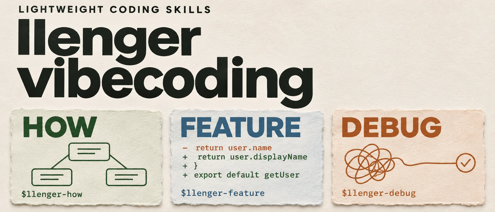

<p align="center"><strong>简体中文</strong> · <a href="README.en.md">English</a></p>

<p align="center">
  
</p>

# llenger-vibecoding

**看懂项目，做出功能，修到根因。**

面向 **Codex / ZCode** 的三个轻量开发 Skill。按需显式调用，由主 Agent 推进；开发与修复以实际验证和独立 Review 收尾。

[选一个入口](#选一个入口) · [安装](#安装) · [宿主与审查](#宿主与审查) · [设计与验证](#设计与验证)

## 选一个入口

### 🧭 How · 先看懂，再决定怎么改

理解陌生开源项目，梳理运行链路、部署关系与后续修改入口。默认只读，在对话里交付。

```text
$llenger-how 帮我理解这个开源项目，重点看部署方式、模型请求链路，
以及接入自定义 provider 应该改哪里。
```

### 🛠️ Feature · 把想法做成可验收的功能

收敛目标、范围和验收条件，完成最小充分实现，再验证行为并独立审查。

```text
$llenger-feature 给任务列表增加按状态筛选，先结合现有代码收敛需求。
```

### 🔍 Debug · 从现象追到故障源头

从截图、报错或一句故障描述出发，查证根因，针对性修复并回归验证。

```text
$llenger-debug 搜索结果翻到第二页后切换筛选条件，页面显示为空，
请追查并修复。
```

三个入口各自独立。How 不作为开发的前置步骤；已有 handoff 继续承接工作进度。

## 安装

克隆仓库，将 Skill 链接到用户级目录。以下适用于 macOS / Linux shell 的首次安装：

```sh
git clone https://github.com/zj-linjie/llenger-vibecoding.git
cd llenger-vibecoding

mkdir -p "$HOME/.agents/skills"
ln -s "$PWD/skills/llenger-how" "$HOME/.agents/skills/llenger-how"
ln -s "$PWD/skills/llenger-feature" "$HOME/.agents/skills/llenger-feature"
ln -s "$PWD/skills/llenger-debug" "$HOME/.agents/skills/llenger-debug"
```

已安装的 Skill 跳过对应链接命令；`ln -s` 不覆盖同名目标。链接指向本仓库，移动仓库后需更新链接。若未出现，重启宿主后重试。

在目标项目中使用上面的调用示例。ZCode 将 `$llenger-how`、`$llenger-feature`、`$llenger-debug` 换成 `/llenger-how`、`/llenger-feature`、`/llenger-debug`。

## 工作方式

| 入口 | 怎样推进 | 交付到哪里 |
| --- | --- | --- |
| [How](skills/llenger-how/SKILL.md) | 问题 → 调用链与部署关系 → 修改建议 | 只读调查结果 |
| [Feature](skills/llenger-feature/SKILL.md) | 任务书 → 实现 → 验证 → 独立 Review | 本地功能变更 |
| [Debug](skills/llenger-debug/SKILL.md) | 现象 → 根因证据 → 修复 → 回归 → 独立 Review | 本地故障修复 |

- **范围先清楚。** 查得到的问题先查，影响产品方向和验收的选择再集中讨论。
- **证据能核查。** 区分源码事实、运行观察与推断；测试关注行为，验证确认运行版本和关键副作用。
- **流程保持轻量。** 三个 Skill 都是纯指令，无运行时依赖；复用已有 Reviewer，不附带调度器、模型配置或角色定义。

创建分支、commit、push、PR、部署等操作按会话授权执行。缺少验证或独立审查时，会明确报告尚未完成的部分。

## 宿主与审查

**How** 由主 Agent 完成，不需要子 Agent。**Feature / Debug** 需要宿主提供子 Agent 调用能力及已配置的 `Reviewer`：

- **Codex：** 例如 `~/.codex/agents/Reviewer.toml`，以新鲜上下文独立审查。
- **ZCode：** 复用 `~/.zcode/agents/Reviewer.md`，每次调用使用全新上下文。

Reviewer 只审查，不修改被审代码或派生子代理；主 Agent 处理发现并负责验收。角色不可用时，继续可完成的工作，并明确报告「独立 Review 未完成」。

<details>
<summary>调用策略与宿主说明</summary>

三个 Skill 仅显式调用。各自的 `agents/openai.yaml` 通过 `policy.allow_implicit_invocation: false` 关闭 Codex 隐式触发；ZCode 忽略该文件，按斜杠命令调用。

仓库不提供 Reviewer 角色文件，不改变现有角色或模型设置。安装与发现方式参考 [Codex Skill 文档](https://learn.chatgpt.com/docs/build-skills)。

</details>

## 设计与验证

Feature、Debug 已有实战使用反馈；How 通过隔离样例，真实项目验证仍待补充。具体范围和未覆盖项见 [验证记录](docs/validation.md)，确认后的需求见 [任务书](docs/task-spec.md)。

选择性借鉴 [pstack](https://github.com/cursor/plugins/tree/main/pstack) 的项目理解、职责边界、根因判断和行为验证理念，按个人开发习惯重新编写。后续迭代继续围绕实际使用中的问题展开。
